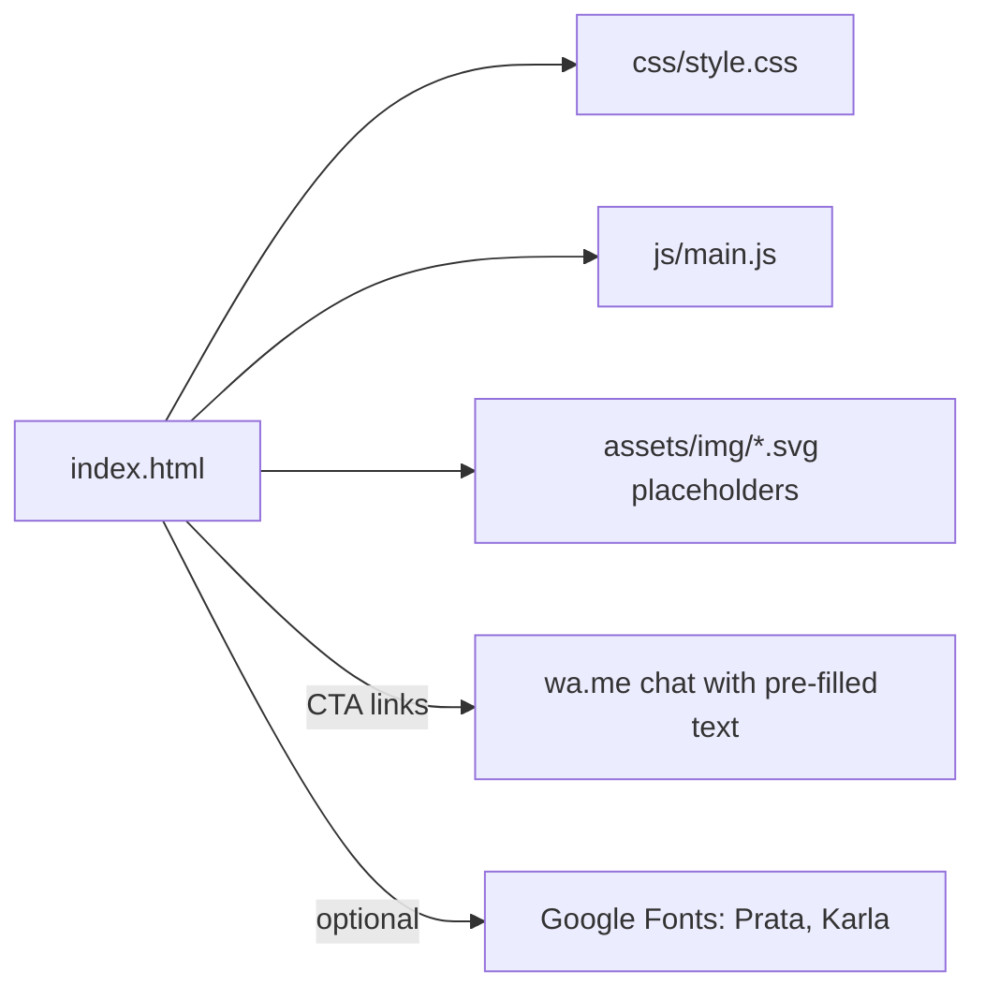

# Luzia Amélia: editorial landing page concept

A single-page, static landing page concept for a small bridal and party dress atelier. It was designed as a prospecting pitch: a finished-looking page a local business owner can react to before any commercial conversation.

"Luzia Amélia" is a working title. All business data in this repository is fictional. The address, phone, WhatsApp number, social handle, opening hours and testimonials are placeholders, and the photos are generated SVG placeholders. Nothing here represents a real store, real clients or real results.

## The problem

Small local businesses often have only a social profile and a chat number. A cold message saying "you need a website" is easy to ignore. A concrete page, built from public information and clearly marked as a proposal, is a better conversation starter.

## Engineering decisions

- Plain HTML, CSS and a few lines of vanilla JS. No framework, no build step, nothing to install. Any static host can serve it.
- One conversion path: every call to action opens a WhatsApp chat with a pre-filled message (the number is a fictional `5500000000000`).
- Editorial look: serif headings, restrained palette, generous whitespace, light hover motion that respects `prefers-reduced-motion`.
- Local SEO basics kept as structure (semantic `address`, JSON-LD with placeholder data) so a real deployment only swaps values.
- Responsive at two breakpoints (980px and 620px), with a slide-down menu on mobile.

## Architecture



## How to run

Open `index.html` in a browser, or serve the folder:

```bash
python -m http.server 8000
# then open http://localhost:8000
```

Fonts come from Google Fonts; offline, the page falls back to system serif and sans fonts.

## Before reusing it for a real business

Replace the placeholder text, images and contact data with confirmed information, and only use photos and reviews you have the right to use. `scripts/scan_sensitive.py` is a small stdlib script that looks for leftover keys, e-mails, phone numbers and local paths.

## Limitations

- This is a concept. There are no conversion numbers, no A/B tests and no claims of results.
- Images are placeholders, so the visual weight of the real page will differ.
- No contact form, analytics, canonical URL or social preview image.
- Accessibility was reviewed by hand only (contrast, focus states, alt text); no automated audit was run.

Built with AI assistance; design, domain rules and review by the author.
